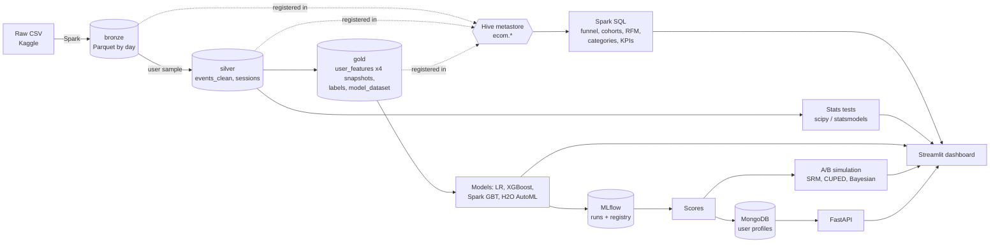

# E-commerce Experimentation & Propensity Platform

An end-to-end analytics project on two months of e-commerce clickstream: a Spark/Hive data
pipeline, SQL analytics, inferential statistics, purchase-propensity models, a simulated A/B
test with CUPED and Bayesian analysis, MongoDB-backed scoring API, and a Streamlit dashboard -
all driven by one CLI and covered by tests and CI.

## Team

- Krrish Tomar
- Nikhil Parihar
- Sriya Desabhatla

| Skill | Where it lives |
|---|---|
| Python, packaging, CLI | `src/ecom/` (`ecom <step>`), `pyproject.toml` |
| Big data: Spark, Hive, Hadoop | Spark 3.5 local mode, Hive metastore (`ecom.*` tables), medallion Parquet; optional HDFS in `docker-compose.yml` |
| SQL | `src/ecom/sql/*.sql` - CTEs, window functions (RANK, NTILE, LAG, running sums), joins; DuckDB for ad-hoc analysis |
| Descriptive stats & visualisation | `src/ecom/analysis/eda.py`, `reports/figures/`, dashboard |
| Inferential stats | `src/ecom/stats/` - z/chi-square, Welch, Mann-Whitney, Kruskal-Wallis + Dunn, Spearman, bootstrap, Benjamini-Hochberg |
| Machine learning | `src/ecom/models/` - logistic regression, XGBoost + Optuna, Spark MLlib GBT, H2O AutoML, SHAP, MLflow registry |
| Experimentation | `src/ecom/experiment/` - power analysis, hashed assignment, SRM, CUPED/CUPAC, segments, Bayesian, peeking simulation |
| NoSQL & serving | MongoDB documents + FastAPI (`src/ecom/serving/`) |
| Communication | `reports/report.md`, `reports/business_memo.md`, `reports/slides.md`, dashboard |

> **Data.** [Kaggle: eCommerce behavior data from multi category store](https://www.kaggle.com/datasets/mkechinov/ecommerce-behavior-data-from-multi-category-store),
> Oct-Nov 2019: 109.6M clickstream events from 5.3M users (~14 GB), which needs a Kaggle account.
> Download it with `ecom download` and run `ecom --source kaggle all`, or run the whole pipeline
> remotely on Kaggle's GPUs with `ecom kaggle push` (see below).

## Results

<!-- RESULTS:START -->
_Last run: 2025-03-30 02:38 UTC · source **kaggle** · user sample **100%**_

| Area | Result |
|---|---|
| Scale | 109,563,335 events, 5,315,274 users, 22,995,676 sessions analysed |
| Funnel | view 5,314,747 -> cart 1,053,172 -> purchase 565,616 users; session conversion 6.10% |
| Stats | 5 of 5 hypothesis tests significant after Benjamini-Hochberg |
| Best model | XGBoost + Optuna: test PR-AUC 0.192 (base rate 0.024), ROC-AUC 0.809, top-decile lift 5.0x |
| Simulated A/B test | conversion 2.37% -> 2.48% (+5.0%, p = 3.5e-11), SRM p = 0.799, CUPED variance -12% |
| Decision | **SHIP** (on the simulated test) |
<!-- RESULTS:END -->

Full write-up: [technical report](reports/report.md) · [business memo](reports/business_memo.md) ·
[slides](reports/slides.md) · [data quality](reports/data_quality.md)

## Architecture



## Quick start

Requirements: Python 3.11, Kaggle credentials and ~15 GB of free disk for the raw data. Java, winutils (Windows) and MongoDB are
downloaded into `.tools/` by `ecom setup`; Docker is optional.

```bash
uv venv --python 3.11 .venv            # or: python3.11 -m venv .venv
source .venv/bin/activate              # Windows: .venv\Scripts\activate
uv pip install -e ".[dev]"             # or: pip install -e ".[dev]"

ecom setup                             # JDK 17 (+winutils on Windows) and MongoDB into .tools/
ecom mongo start                       # local MongoDB on :27017 (data in data/mongo)
ecom download                          # raw dataset from Kaggle
ecom --source kaggle --sample 0.05 all   # whole pipeline on a 5% user sample
ecom serve                             # API on http://localhost:8000/docs
ecom dashboard                         # dashboard on http://localhost:8501
```

`make test` and `make lint` wrap the test and lint commands where `make` exists. All temp,
spill and cache directories (Spark, Hive scratch, H2O, Jupyter, matplotlib) are kept inside
`.cache/` in the project (`src/ecom/env.py`).

### Pipeline commands

| Command | What it does |
|---|---|
| `ecom ingest` | CSV -> typed bronze Parquet (partitioned by day), data-quality report, deterministic user sample, Hive tables |
| `ecom transform` | silver `events_clean` (deduplicated, valid) and `sessions` |
| `ecom features` | gold point-in-time `user_features` for 4 snapshots, `labels`, `model_dataset` |
| `ecom sql` | funnel, cohorts, RFM, category and KPI queries -> CSV (+ `rfm_users` table) |
| `ecom eda` | EDA figures and quantified insights |
| `ecom stats` | hypothesis tests with effect sizes, CIs and BH correction |
| `ecom train` | LR, XGBoost+Optuna, Spark GBT, H2O AutoML; calibration, SHAP, MLflow registry, batch scoring |
| `ecom abtest` | power analysis, simulated targeted-coupon test, SRM, CUPED, segments, Bayesian, peeking |
| `ecom load-mongo` | upsert user documents (features, propensity, decile, RFM segment) with indexes |
| `ecom report` | render `reports/*.md` and the results table above from the latest outputs |
| `ecom benchmark` | pandas vs DuckDB vs Spark on the full bronze table |
| `ecom notebooks` | build and execute `notebooks/01-04` |
| `ecom all` | ingest -> ... -> report in one process |
| `ecom evaluate-model --model <dir>` | score a saved MLflow model on the active source's valid/test snapshots |
| `ecom kaggle push\|status\|logs\|pull` | run the pipeline on the real data in a private Kaggle kernel (GPU T4 x2) |

Global flags: `--sample <rate>` and `--source kaggle`. Any config value can be
overridden with `ECOM__SECTION__KEY=value` (e.g. `ECOM__ML__H2O_MAX_RUNTIME_S=1200`).

### Real data on Kaggle GPUs

`ecom kaggle push` needs only Kaggle CLI credentials (`kaggle config view` shows your user).
It builds one self-contained private kernel script (`src/ecom/kaggle_entry.py` plus a
base64 tar.gz of the source, the exact package versions of your venv and your registered
champion model), attaches the dataset and starts it on a T4 x2 session. Remotely it creates a
Python 3.11 venv with uv, runs `ecom --source kaggle --sample <s> all` for each sample in
`kaggle.samples` (XGBoost trains on the GPU), then scores your local champion on the same
real snapshots (`external_model_eval.json`). `ecom kaggle
pull` files the results under `data/outputs/kaggle/<tag>/` (shown by the dashboard's run
selector), `reports/kaggle/<tag>/` and `models/kaggle/<tag>/champion/`. Remote resource
settings live in the `kaggle:` section of `configs/config.yaml`.

### API

| Endpoint | Returns |
|---|---|
| `GET /health` | MongoDB status and document count |
| `GET /users/{id}/score?live=true` | stored propensity, decile, tier, RFM segment, model version; `live=true` re-scores with the MLflow champion and reports whether it matches |
| `GET /segments` | users and mean propensity per segment |
| `GET /segments/{name}/top?k=10` | top-k users by propensity in a segment |
| `POST /score` | live score for a feature vector |

## Design decisions

- **Time-based splits and point-in-time features.** Each snapshot sees only the 21 days before
  its cutoff; labels look at the following 7 days. Train on October, validate early November,
  test late November. `tests/test_labels.py` proves features ignore everything after the cutoff.
- **PR-AUC as the primary metric** (about 2-3% of users buy in a given week), champion chosen on
  validation, scores Platt-calibrated because the experiment and API treat them as probabilities.
- **User-level, hash-based sampling and assignment** keep users' histories intact and make every
  run reproducible.
- **Reports are rendered from results**, so the numbers in the docs can never drift from the code.
- **One visual system** (`src/ecom/viz.py`): validated colour-blind-safe palette, no dual axes.

## Repository layout

```
configs/config.yaml        all parameters (paths, sample rate, splits, model and experiment settings)
src/ecom/                  the package (cli, pipeline, ingest, transform, sql, stats, models, experiment, serving)
dashboard/app.py           Streamlit dashboard
notebooks/                 01_eda, 02_stats, 03_modeling, 04_abtest (generated by `ecom notebooks`)
reports/                   report.md, business_memo.md, slides.md, data_quality.md, figures/, templates/
tests/                     unit + Spark integration tests
docs/PLAN.md               the original project plan
HANDOFF.md                 status and notes for whoever continues the work
graphify-out/              knowledge graph of the codebase (GRAPH_REPORT.md, graph.html)
```

## Testing

```bash
pytest                      # unit tests + Spark integration tests (needs Java 17; `ecom setup` provides it)
pytest -m "not spark"       # fast subset without Spark
ruff check . && ruff format --check .
```

CI (`.github/workflows/ci.yml`) runs lint and the full test suite on every push.
