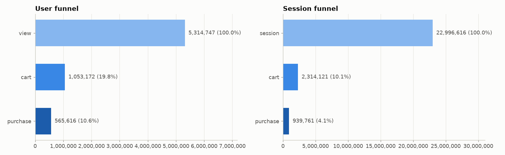
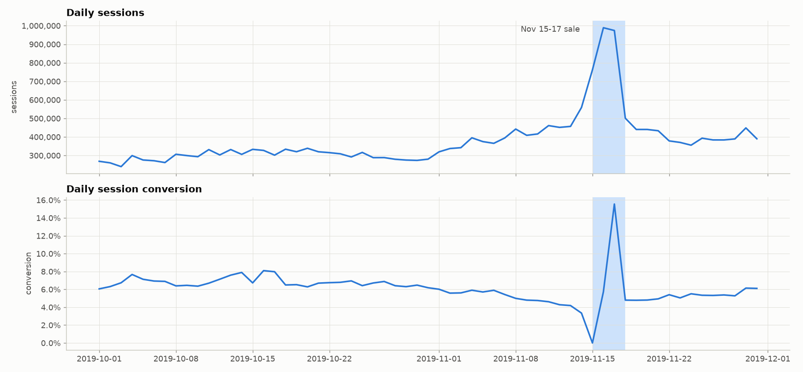
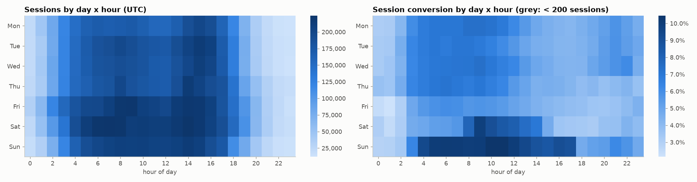
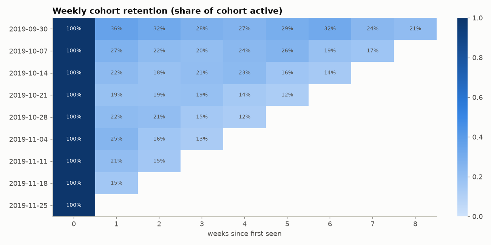
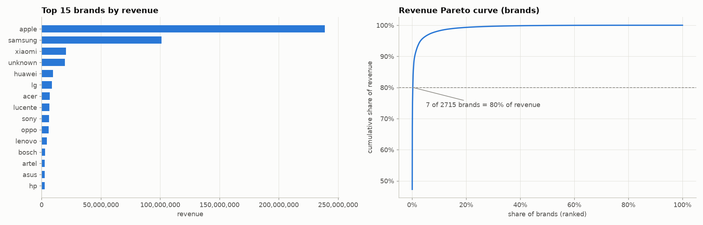
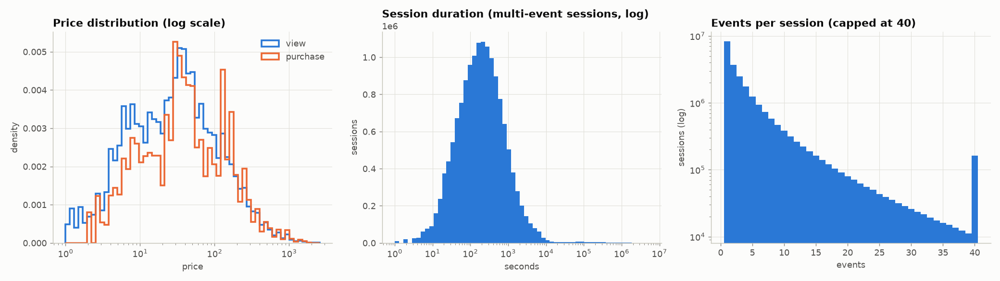
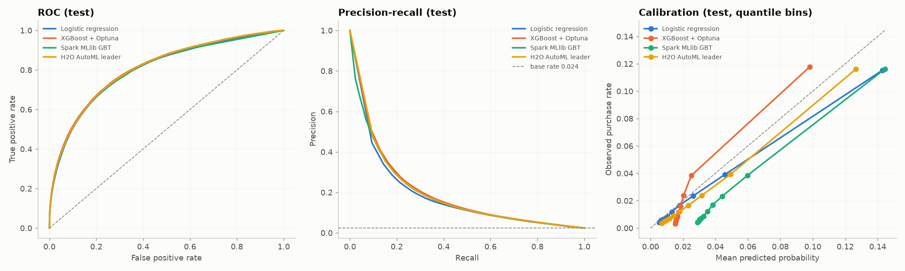
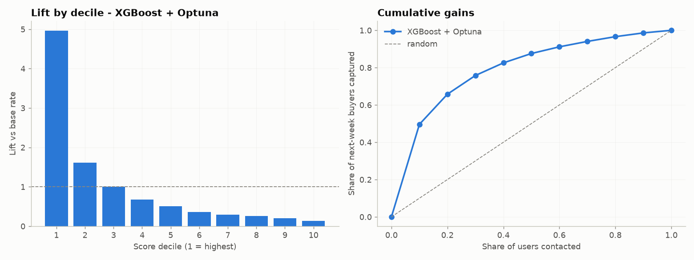
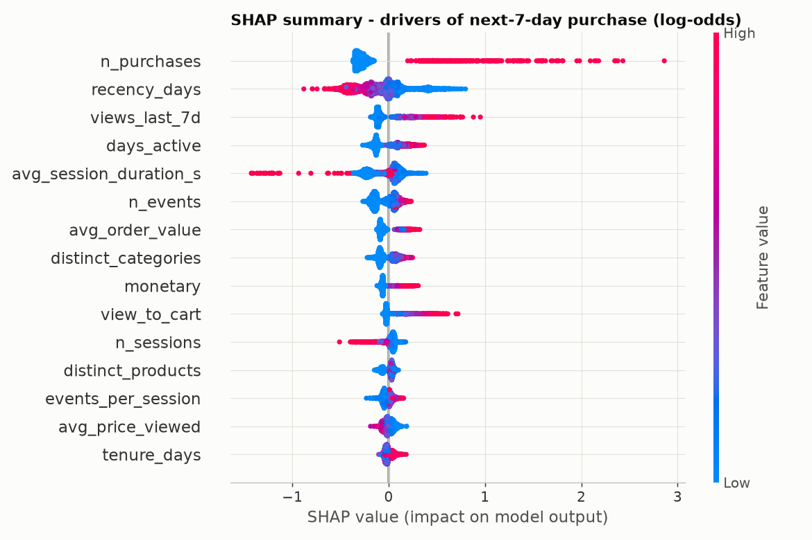
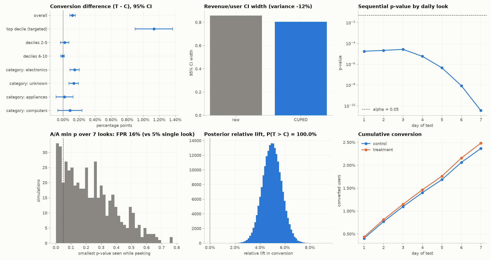

# E-commerce Experimentation & Propensity Platform - Technical Report

_Generated 2026-11-01 18:26 UTC by `ecom report` from the outputs of the last pipeline run
(source: **kaggle**, user sample: **100%**). Every number below is
filled in from `data/outputs/`, so re-running the pipeline on other data rewrites this report._


## 1. Summary

| | |
|---|---|
| Events analysed | 109,563,335 (5,315,274 users, 22,995,676 sessions, 2019-10-01 to 2019-11-30) |
| Revenue | 505,126,293 from 1,659,703 purchases by 697,470 buyers |
| Session conversion | 6.10% (user conversion 13.1%) |
| Best propensity model | XGBoost + Optuna: test PR-AUC 0.192 vs base rate 0.024, top-decile lift 5.0x |
| Experiment | conversion 2.37% -> 2.48% (+5.0%, p = 3.5e-11); CUPED cut revenue variance by 12% |
| Decision | **SHIP** |

## 2. Data and pipeline

**Architecture.** Raw Kaggle-format CSVs are converted by Spark into typed Parquet
(**bronze**, partitioned by `event_date`), cleaned and sessionised (**silver**), and turned into
point-in-time user features, labels and scores (**gold**). Every table is registered as an
external table in the Hive metastore (`ecom.*`, embedded Derby metastore), so all SQL runs
against `ecom.events_clean`, `ecom.sessions`, `ecom.user_features` and friends. Small result
sets are exported for the dashboard; MongoDB serves per-user profiles to a FastAPI service;
MLflow tracks every model run and holds the registered champion.

```
CSV --Spark--> bronze (Parquet/Hive) --> silver: events_clean, sessions
                                     --> gold: user_features x4 snapshots, labels, model_dataset
                                     --> SQL (funnel, cohorts, RFM, categories, KPIs) --> CSV
gold --> stats (scipy/statsmodels) | models (sklearn, XGBoost, Spark MLlib, H2O) --> MLflow
champion --> scores --> MongoDB --> FastAPI  --> Streamlit dashboard
```

**Development workflow.** Everything is built on a deterministic **user-level** sample
(`xxhash64(user_id, seed) mod 10000 < rate x 10000`): sampling whole users keeps each user's
history intact, so per-user features and labels are unbiased. This run used
100% of users.

**Data quality** (full bronze table, 109,950,743 rows; details in
[data_quality.md](data_quality.md)):

- 130,739 exact duplicate rows (0.12%) and
  256,761 zero / 0 negative prices, dropped in silver;
- `category_code` missing on 32.2% and `brand` on
  13.9% of rows (kept as `unknown`, as in the real dataset);
- `user_session` missing on 0.000% of rows (dropped: cannot be sessionised).


## 3. Descriptive analytics



- cart: 1,053,172 users (19.8% of viewers, step conversion 19.8%)
- purchase: 565,616 users (10.6% of viewers, step conversion 53.7%)

**Insights**

1. The top 1% of users generate 51% of revenue and the top 10% generate 98%; only 13.1% of visitors buy anything in two months.
2. 20% of viewers ever add to cart, and 54% of those go on to buy - the view-to-cart step is where most users are lost.
3. Sessions convert at 4.1%; half of all multi-event sessions last under 3.1 minutes and 36% of sessions are a single page view.
4. The Nov 15-17 sale lifted daily traffic 2.6x and conversion from 5.9% to 7.6%.
5. Electronics drives 76% of revenue; auto.accessories.winch has the highest average order value (664).
6. Revenue is concentrated in brands too: 7 of 2715 brands (0%) make up 80% of it.
7. Buyers pay a median 174 per item vs a median 165 for viewed items, so cheaper items convert better.
8. Only 22% of a weekly cohort comes back the next week; traffic peaks at 15:00 UTC.







**RFM segments** (NTILE quintiles over buyers, `src/ecom/sql/rfm.sql`):

| Segment | Users | Share of buyers | Revenue share | Avg recency (days) | Avg orders |
|---|---:|---:|---:|---:|---:|
| champions | 136,051 | 19.5% | 45.3% | 8.6 | 4.09 |
| at_risk | 86,225 | 12.4% | 20.2% | 42.3 | 2.78 |
| loyal | 56,712 | 8.1% | 15.0% | 20.9 | 3.32 |
| potential_loyalists | 76,198 | 10.9% | 7.5% | 13.8 | 1.00 |
| need_attention | 120,076 | 17.2% | 7.2% | 33.9 | 1.00 |
| hibernating | 129,467 | 18.6% | 2.8% | 44.8 | 1.00 |
| new_customers | 92,741 | 13.3% | 2.0% | 9.6 | 1.00 |

## 4. Inferential statistics

Each test states its hypotheses, checks its assumptions, and reports an effect size with a
confidence interval. The family of primary tests is corrected with Benjamini-Hochberg (FDR 5%).

| Question | Test | Effect | 95% CI | p | p (BH) |
|---|---|---|---|---:|---:|
| Session conversion: weekend vs weekday | two-proportion z-test | Cohen's h = 0.073 | 0.018 to 0.018 (p_B - p_A) | < 1e-16 | < 1e-16 |
| Session conversion x weekend (chi-square) | Pearson chi-square test of independence | phi = 0.034 | - | < 1e-16 | < 1e-16 |
| Order value across top 5 categories | Kruskal-Wallis H (ANOVA assumptions failed) | epsilon-squared = 0.245 | - | < 1e-16 | < 1e-16 |
| Session duration: buyers vs non-buyers | Mann-Whitney U (two-sided) | rank-biserial r = 0.184 | 67.000 to 80.000 (median_B - median_A (bootstrap)) | < 1e-16 | < 1e-16 |
| Product price vs view->purchase conversion (products with >= 30 views) | Spearman rank correlation | Spearman rho = -0.073 | -0.079 to -0.068 (rho (Fisher z, Bonett-Wright SE)) | < 1e-16 | < 1e-16 |

Interpretation:

- **Session conversion: weekend vs weekday.** H0: conversion(weekend) = conversion(weekday). Rejected after BH correction (Cohen's h 0.073).
  Weekend sessions convert at 7.35% vs 5.55% on weekdays
  (+32.2% relative). Caveat: sessions of one user are correlated, so the
  z-test's independence assumption holds only approximately.
- **Session conversion x weekend (chi-square).** H0: outcome independent of group. Rejected after BH correction (phi 0.034).
- **Order value across top 5 categories.** H0: all groups share the same mean/distribution. Rejected after BH correction (epsilon-squared 0.245).
  ANOVA assumptions failed (Shapiro-Wilk / Levene), so the rank-based Kruskal-Wallis test was used;
  Dunn post-hoc pairs (BH-adjusted) are in `stats_tests.json`. Medians:
electronics 269, appliances 136, computers 299, apparel 83, auto 121.
- **Session duration: buyers vs non-buyers.** H0: distributions of A and B are equal (no stochastic dominance). Rejected after BH correction (rank-biserial r 0.184).
  Buyers' sessions are longer (median 256 s vs 177 s);
  durations are heavily skewed, hence the Mann-Whitney U test rather than a t-test.
- **Product price vs view->purchase conversion (products with >= 30 views).** H0: rho = 0 (no monotonic association). Rejected after BH correction (Spearman rho -0.073).
  Across 124,062 products, pricier items convert less often (a monotonic,
  not necessarily linear, relationship - hence Spearman).

**Bootstrap (BCa) 95% CIs for the median order value:**
all orders 245.3 [242.9, 246.5]; electronics 270.7 [265.6, 276.2]; appliances 136.2 [131.2, 136.4]; computers 298.6 [298.3, 303.5]; apparel 82.6 [82.6, 84.4]; auto 121.2 [121.2, 123.5].

## 5. Propensity model

**Task.** Predict whether a user purchases in the next 7 days from
their behaviour in the previous 21 days. Snapshots are time-based to
avoid leakage: train cutoff 2019-10-22, validation 2019-11-08,
test 2019-11-24. Features only see events strictly before the cutoff and labels
only the window after it; `tests/test_labels.py` asserts that features computed on the full
history equal those computed on history truncated at the cutoff.

| Split | Users | Positive rate |
|---|---:|---:|
| train | 2,311,484 | 2.79% |
| valid | 2,483,574 | 2.47% |
| test | 3,011,839 | 2.38% |

**Features (29 numeric + top category):** RFM (recency, frequency, monetary, AOV), funnel ratios
(view-to-cart, cart-to-purchase, cart abandonment), breadth (distinct categories, brands,
products), price level and price sensitivity (carted vs viewed price), timing (weekend and
evening share, session length), and last-7-day activity and trend.

| Model | Valid PR-AUC | Test PR-AUC | Test ROC-AUC | Brier | Top-decile precision | Top-decile lift | Train time (s) |
|---|---:|---:|---:|---:|---:|---:|---:|
| XGBoost + Optuna **(champion)** | 0.203 | 0.192 | 0.809 | 0.0216 | 11.8% | 4.96x | 1,869.3 |
| H2O AutoML leader | 0.198 | 0.187 | 0.807 | 0.0212 | 11.6% | 4.88x | 1,299.3 |
| Spark MLlib GBT | 0.199 | 0.187 | 0.804 | 0.0217 | 11.6% | 4.89x | 219.2 |
| Logistic regression | 0.186 | 0.173 | 0.801 | 0.0214 | 11.5% | 4.85x | 67.3 |

PR-AUC is the primary metric because only 2.4% of users buy
in a given week (a random model scores PR-AUC = base rate). The champion is selected on
**validation** PR-AUC among the servable sklearn-compatible models, then evaluated once on test.
Scores are Platt-calibrated on the validation snapshot, so they can be read as probabilities.
H2O AutoML (5 best of its leaderboard shown in `h2o_leaderboard.csv`)
and Spark MLlib GBT (distributed, trained inside Spark on the Hive table) are benchmarks.




**What drives the prediction (SHAP on the XGBoost model):**

1. Number of past purchases: the more of it, the higher the chance of buying next week. Users in the top quartile have 1.14x the purchase odds of users in the bottom quartile.
2. Days since the user's last visit: the more of it, the lower the chance of buying next week. Users in the top quartile have 0.55x the purchase odds of users in the bottom quartile.
3. Views in the last 7 days: the more of it, the higher the chance of buying next week. Users in the top quartile have 1.40x the purchase odds of users in the bottom quartile.
4. Number of active days: the more of it, the higher the chance of buying next week. Users in the top quartile have 1.37x the purchase odds of users in the bottom quartile.
5. Average session length: the more of it, the higher the chance of buying next week. Users in the top quartile have 1.21x the purchase odds of users in the bottom quartile.



## 6. A/B experiment

### Design document

- **Hypothesis.** Sending a 10% coupon to the users in the top
  1 propensity decile(s) increases next-7-day conversion.
- **Unit and assignment.** User; deterministic SHA-256 hash of `salt:user_id`, 50/50 split
  (`src/ecom/experiment/simulate_ab.py`). The salt was chosen **before launch** by a seedfinder
  search over candidate salts, using only assignment counts and pre-period covariates
  (balance criteria: SRM p >= 0.2, |standardized mean
  difference| <= 0.02 on pre-spend, propensity and sessions):
  `promo-2019-11` after 1 candidate(s).
- **Population.** Users active in the 21 days before 2019-11-24 (held-out test
  snapshot; no model has seen their outcomes): 3,011,839 users.
- **Primary metric.** Conversion (share of users who purchase within 7 days), analysed
  intention-to-treat over the whole arm.
- **Guardrails.** Revenue per user (must not drop significantly) and buyer average order value
  (must not drop by more than 10%).
- **Error rates.** alpha = 0.05, power = 80%, minimum detectable
  effect = 10% relative on a baseline of 2.38%.
- **Sample size** (`statsmodels` `NormalIndPower`, Cohen's h = 0.0152):
  **67,587 users per arm**, i.e. about
  **1 days** at 246,102 eligible users per day.
  This run has 1,505,919 per arm, so its MDE is
  2.1% (power 100% for a
  10% lift).

**Simulation assumptions** (the effect is simulated; outcomes in control are observed data):
the coupon multiplies a targeted user's purchase odds by `1 + 0.25 x s`,
where `s` is the user's price-sensitivity percentile and the baseline probability is the
calibrated model score; newly converted users spend their average viewed price minus the
discount; users who would have bought anyway still redeem it (the cost the guardrails watch).

### Results

| Check / metric | Control | Treatment | Difference (95% CI) | p |
|---|---:|---:|---|---:|
| SRM (users per arm) | 1,505,699 | 1,506,140 | expected 50/50 | 0.799 |
| Conversion (primary) | 2.37% | 2.48% | 0.12% (0.08% to 0.15%); relative +5.0% | 3.5e-11 |
| Conversion, CUPAC (score covariate) | | | 0.11% (0.08% to 0.15%) | 1.8e-11 |
| Revenue / user, raw (Welch) | 12.30 | 12.14 | -0.16 (-0.58 to 0.27) | 0.477 |
| Revenue / user, CUPED | | | -0.19 (-0.60 to 0.21) | 0.348 |
| Buyer AOV (guardrail) | 269.6 | 257.3 | -4.6% | 6e-08 |

**CUPED.** Using pre-period spend as covariate (theta = 0.123,
correlation 0.35) reduced the variance of revenue per user
by 12% and the CI width by
6%, without changing the expected effect. The same idea
with the model score as covariate (CUPAC) reduced conversion variance by
8%.

**Segments** (BH-adjusted):

| Segment | Control | Treatment | Relative lift | p (BH) |
|---|---:|---:|---:|---:|
| top decile (targeted) | 11.70% | 12.83% | +9.7% | < 1e-16 |
| deciles 2-5 | 2.25% | 2.27% | +0.9% | 0.660 |
| deciles 6-10 | 0.59% | 0.59% | -1.0% | 0.734 |
| category: electronics | 2.69% | 2.84% | +5.4% | 3.5e-06 |
| category: unknown | 2.23% | 2.36% | +5.9% | 3.2e-05 |
| category: appliances | 2.35% | 2.37% | +0.8% | 0.737 |
| category: computers | 2.15% | 2.24% | +4.0% | 0.466 |

**Bayesian view** (Beta(1,1) priors): P(treatment > control) = 100.0%,
relative lift +5.0% (95% credible interval
+3.5% to +6.5%),
expected loss of shipping 0.000% conversion points.

**Peeking pitfall.** In 500 A/A tests on the untreated outcomes,
checking the p-value after each of the 7 days and stopping at the first
p < 0.05 produced a false-positive rate of **15.6%** instead of
5.0% for a single look at the planned end. Keeping the
family-wise rate at 5% with daily looks needs a per-look threshold of about
0.0145 (an empirical Pocock boundary) - or simply a
fixed horizon.



### Decision: SHIP

- SRM check passed (p = 0.799).
- Conversion 2.37% -> 2.48% (+5.0% relative, p = 3.46e-11): significant improvement.
- Revenue/user (CUPED) diff -0.19 [-0.60, +0.21]: no significant harm.
- Buyer AOV -4.6% (p = 5.97e-08); guardrail allows at most -10%: within guardrail.

## 7. Limitations and next steps

- The treatment effect is simulated from stated assumptions; a real test is the only way to
  measure it, and the propensity model targets *likely buyers*, who are not necessarily the users
  a coupon *changes* - an uplift model (T-learner) would target persuadable users instead.
- Session-level tests treat sessions as independent; a user-clustered analysis would be stricter.
- The Hive metastore is embedded Derby (single process); a shared Postgres-backed metastore is
  the production setup.

## 8. Reproduce

```bash
uv venv --python 3.11 .venv && uv pip install -e ".[dev]"
ecom setup              # JDK 17 (+winutils on Windows) and MongoDB into .tools/
ecom mongo start
ecom --source kaggle --sample 1.0 all
```
