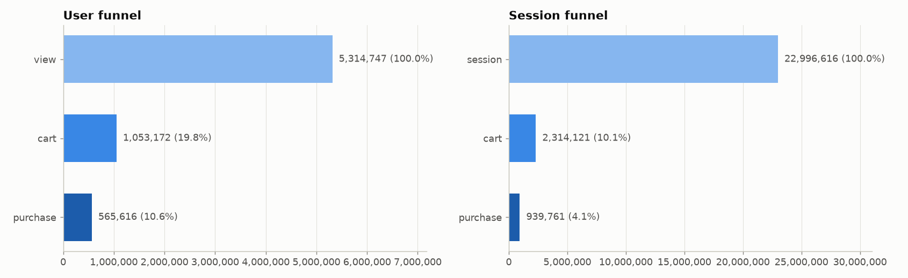
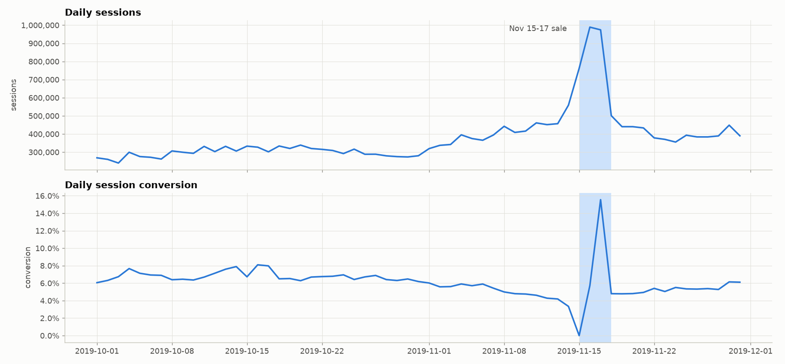
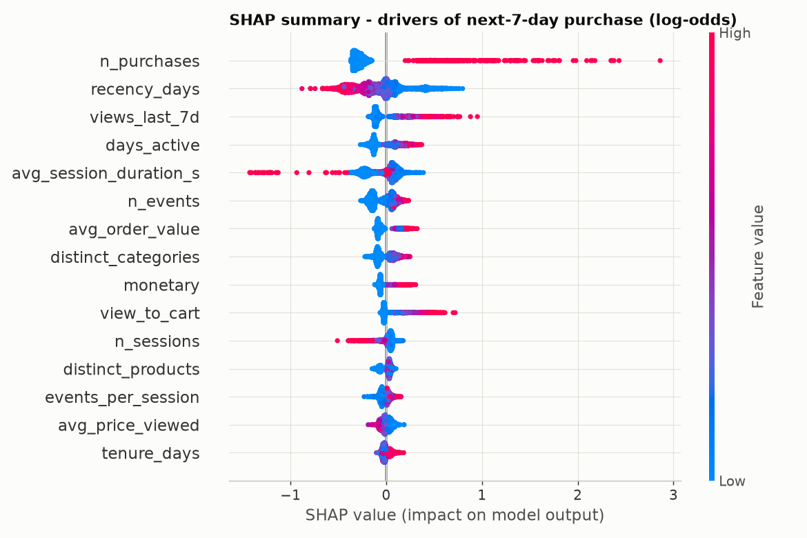
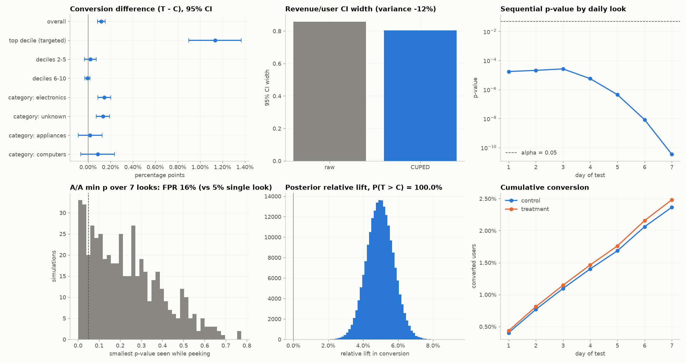

# E-commerce Experimentation & Propensity Platform

Spark/Hive pipeline · SQL analytics · inferential stats · propensity ML · A/B testing · MongoDB + FastAPI · Streamlit


---

## Problem

- Which customers will buy in the next 7 days?
- Does a targeted coupon make them buy more - without losing revenue?
- 109,563,335 events, 5,315,274 users, 22,995,676 sessions (100% user sample)

---

## Architecture

```
CSV -> Spark -> bronze Parquet (Hive) -> silver sessions -> gold features/labels
     -> SQL analytics | stats | ML (sklearn, XGBoost, Spark MLlib, H2O) -> MLflow
     -> scores -> MongoDB -> FastAPI -> Streamlit
```

One command: `ecom all` · tests + lint in CI

---

## Data quality

- 109,950,743 raw rows; 130,739 duplicates and 256,761 zero prices removed
- `category_code` missing on 32% of rows (kept as `unknown`)
- Whole-user sampling keeps histories intact

---

## Funnel and behaviour



- 20% of viewers cart; 54% of carters buy
- Top 1% of users = 51% of revenue

---

## Time patterns and sale



Sale: 2.6x traffic, conversion 5.9% -> 7.6%

---

## Statistical tests (BH-corrected)

| Question | Effect | p (BH) |
|---|---|---|
| Session conversion: weekend vs weekday | Cohen's h 0.073 | < 1e-16 |
| Session conversion x weekend (chi-square) | phi 0.034 | < 1e-16 |
| Order value across top 5 categories | epsilon-squared 0.245 | < 1e-16 |
| Session duration: buyers vs non-buyers | rank-biserial r 0.184 | < 1e-16 |
| Product price vs view->purchase conversion (products with >= 30 views) | Spearman rho -0.073 | < 1e-16 |

---

## Propensity model

| Model | Test PR-AUC | Top-decile lift |
|---|---|---|
| XGBoost + Optuna ★ | 0.192 | 5.0x |
| H2O AutoML leader | 0.187 | 4.9x |
| Spark MLlib GBT | 0.187 | 4.9x |
| Logistic regression | 0.173 | 4.8x |

Base rate 2.4% · time-based split, leakage-tested

---

## Why customers buy (SHAP)



---

## A/B test design

- Coupon 10% to top-decile propensity users, hashed 50/50 split
- Primary: 7-day conversion · guardrails: revenue/user, AOV
- Needs 67,587 users/arm for a 10% MDE (alpha 0.05, power 80%)

---

## A/B test results



---

## Decision: SHIP

- SRM check passed (p = 0.799).
- Conversion 2.37% -> 2.48% (+5.0% relative, p = 3.46e-11): significant improvement.
- Revenue/user (CUPED) diff -0.19 [-0.60, +0.21]: no significant harm.
- Buyer AOV -4.6% (p = 5.97e-08); guardrail allows at most -10%: within guardrail.

CUPED cut revenue variance by 12% · peeking inflates false positives to 16%

---

## Takeaways and next steps

- Prioritise outreach by propensity; fix the view-to-cart leak
- Run every campaign as a pre-registered, fixed-horizon test
- Next: uplift modelling (target persuadable users), real Kaggle data run, shared Hive metastore
